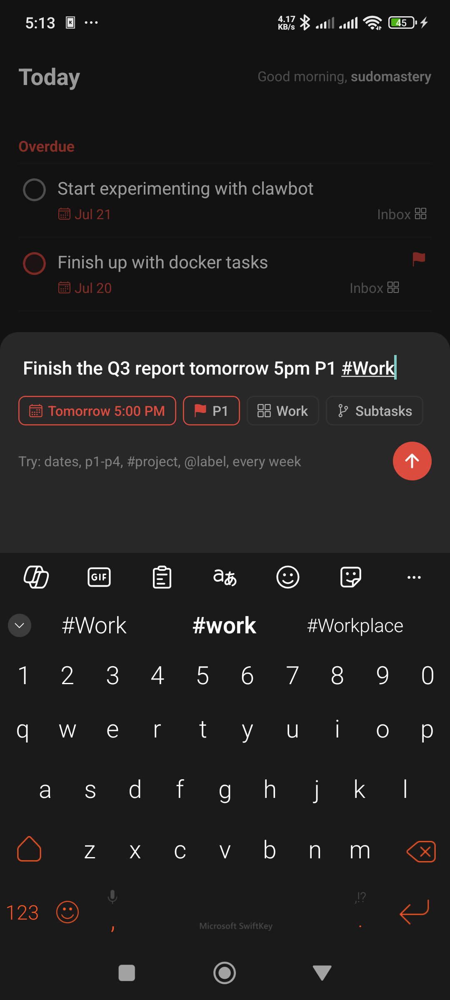
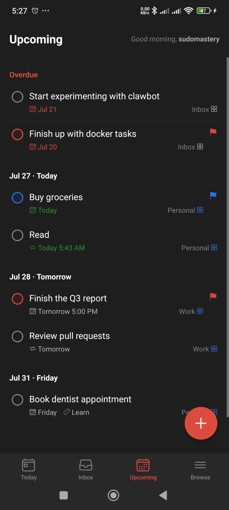
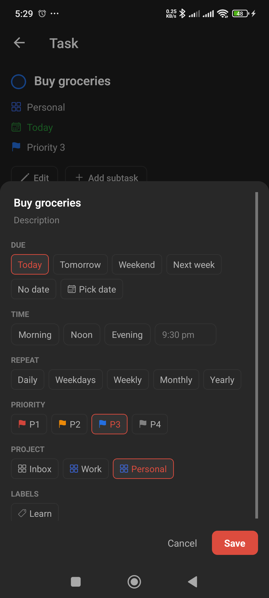
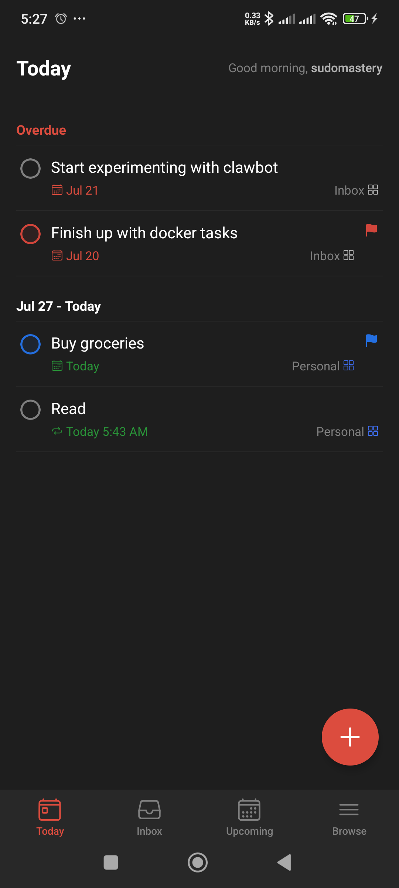
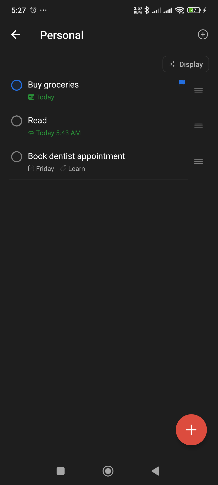
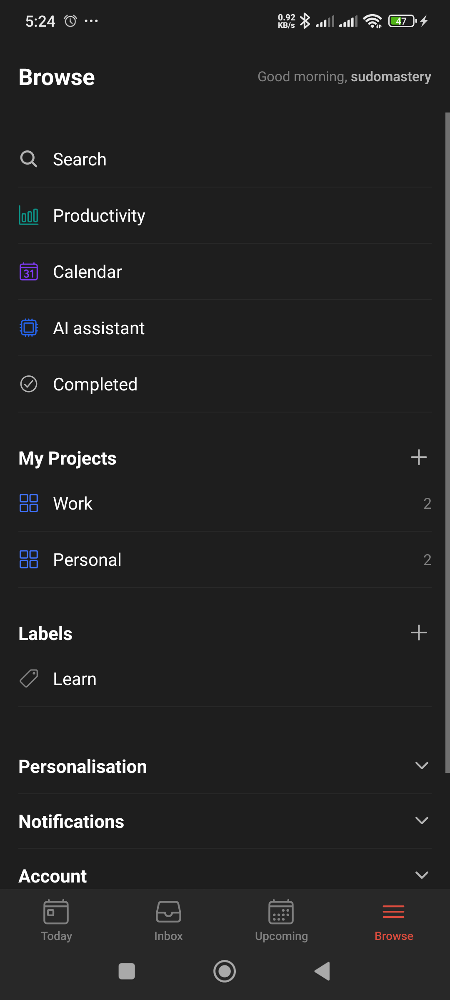

<p align="center">
  
</p>

<h1 align="center">Todoer</h1>

<p align="center">
  A fast, no-nonsense task manager for your phone and browser.<br />
  Type a task in plain English, and it figures out the date, priority, project, and labels for you.
</p>

<p align="center">
  <a href="https://github.com/sudomastery/todoer/releases/download/v1.0.0/app-release.apk">
    
  </a>
  <a href="https://github.com/sudomastery/todoer/releases/tag/v1.0.0">
    
  </a>
</p>

<p align="center">
  <sub>Install: tap the button above to download the APK, open it on your phone, and allow "install from this source" when Android asks (only needed the first time).</sub>
</p>

## What is this?

Todoer is a Todoist-style to-do app: tasks, projects, labels, due dates, recurring reminders, the works. It runs as a web app in your browser and as a native Android app, both talking to the same account, so anything you add on your phone shows up on the web instantly and vice versa.

The Android app also works with **no internet connection**. Add, edit, or check off a task on a plane or in a dead zone, and it applies instantly on your phone and quietly finishes syncing to your account the moment you're back online.

## A tour, in pictures

<table>
  <tr>
    <td align="center" width="33%">
      <br />
      <sub><b>Type it like you'd say it.</b><br />Todoer reads the date, time, priority, and project straight out of the sentence.</sub>
    </td>
    <td align="center" width="33%">
      <br />
      <sub><b>See what's coming.</b><br />Everything overdue or due in the next two weeks, grouped by day.</sub>
    </td>
    <td align="center" width="33%">
      <br />
      <sub><b>Fine-tune anything.</b><br />Due date, repeat rule, priority, project, and labels, all in one sheet.</sub>
    </td>
  </tr>
  <tr>
    <td align="center" width="33%">
      <br />
      <sub><b>Today, front and center.</b><br />Overdue items surface automatically so nothing slips through.</sub>
    </td>
    <td align="center" width="33%">
      <br />
      <sub><b>Group work by project.</b><br />Give each project its own color and its own list.</sub>
    </td>
    <td align="center" width="33%">
      <br />
      <sub><b>Everything else, one tap away.</b><br />Search, productivity stats, a calendar view, and an AI assistant.</sub>
    </td>
  </tr>
</table>

## What it can do

- **Type naturally to add a task.** `Pay rent tomorrow 9am #Bills @finance p1 every month` becomes a task due tomorrow at 9am, in the Bills project, tagged "finance", top priority, repeating monthly.
- **Works offline.** The Android app keeps working with no signal: everything you do applies immediately and syncs up once you reconnect.
- **Recurring tasks that just work.** Every day, every weekday, every Monday, every 3 weeks, monthly, yearly, whatever the reminder needs.
- **Projects, labels, and subtasks** to organize things however you think about them, with 20 colors to tell projects apart at a glance.
- **Today, Upcoming, and overdue handling** so you always know what needs attention first.
- **Instant sync between phone and browser.** Add something on the bus, see it on your laptop before you've sat down.
- **Search and keyboard shortcuts on the web app** (`Ctrl+K` to search, `Q` to add a task).
- **Comments on tasks**, for the extra context that doesn't fit in a title.
- **Talk to it through an AI assistant.** Connect Claude (or any MCP-capable assistant) to your account and ask it to manage your list for you.
- **Dark mode** on both the app and the website.
- **Your data is yours.** Every account's tasks are locked down at the database level, not just in the app's UI.

## Repository layout

```
apps/web          Next.js 15 web app (deploys to Vercel)
apps/mobile       Expo (React Native) Android app
packages/shared   Shared TypeScript: types, quick-add parser, recurrence engine, Supabase queries
packages/mcp      MCP server exposing the app's actions to AI assistants
supabase/         SQL migrations (schema, triggers, RLS, realtime)
```

## Running it yourself

Todoer is built entirely on free tiers: Supabase for the database and auth, Vercel for the web app, Expo for the Android build.

### 1. Set up Supabase (free)

1. Create a project at [supabase.com](https://supabase.com) (free tier).
2. Open the SQL Editor, paste the contents of `supabase/migrations/00000000000001_schema.sql`, and run it.
   Alternatively, with the Supabase CLI: `supabase link --project-ref YOUR_REF && supabase db push`.
3. In Project Settings, API, copy the Project URL and the anon public key.
4. In Authentication, URL Configuration, set the Site URL to your web app URL (use `http://localhost:3000` while developing) and add `https://YOUR-DOMAIN/auth/callback` to the redirect list.

New users automatically get a profile and an Inbox project via a database trigger.

### 2. Run the web app locally

```bash
npm install
cp apps/web/.env.example apps/web/.env.local   # fill in your Supabase URL and anon key
npm run dev                                     # http://localhost:3000
```

### 3. Deploy the web app to Vercel (free)

1. Push this repository to GitHub.
2. Import it on [vercel.com](https://vercel.com), and set the Root Directory to `apps/web`.
3. Add the environment variables `NEXT_PUBLIC_SUPABASE_URL` and `NEXT_PUBLIC_SUPABASE_ANON_KEY`.
4. Deploy. Then update the Supabase Site URL and redirect URLs to your Vercel domain.

### 4. Run the Android app

```bash
cp apps/mobile/.env.example apps/mobile/.env    # fill in the same Supabase values
npm run dev:mobile                              # scan the QR code with the Expo Go app
```

### 5. Build an installable APK (free)

Uses Expo's EAS Build free tier:

```bash
npm install -g eas-cli
cd apps/mobile
eas login                    # free Expo account
```

Edit `apps/mobile/eas.json` and put your Supabase URL and anon key in the `preview` profile `env` block, then:

```bash
eas build --profile preview --platform android
```

When the build finishes you get a download link for an APK you can install directly on any Android phone. For Play Store distribution, use `eas build --platform android` (production profile, builds an AAB) and `eas submit`.

### 6. Connect an AI assistant (MCP)

`packages/mcp` is a stdio MCP server that gives any MCP-capable AI assistant
(Claude Code, Claude Desktop, and others) full control of one Todoer account:
listing, adding, updating, completing, and deleting tasks, managing projects,
sections, and labels, commenting on tasks, exporting data, and reading
productivity stats. It signs in with your normal login and Row Level Security
keeps it scoped to your own data.

With Claude Code:

```bash
claude mcp add todoer \
  --env TODOER_LOGIN=your_username_or_email \
  --env TODOER_PASSWORD=your_password \
  -- npx tsx /absolute/path/to/todoer/packages/mcp/src/index.ts
```

For Claude Desktop, add the same command to `claude_desktop_config.json`:

```json
{
  "mcpServers": {
    "todoer": {
      "command": "npx",
      "args": ["tsx", "/absolute/path/to/todoer/packages/mcp/src/index.ts"],
      "env": {
        "TODOER_LOGIN": "your_username_or_email",
        "TODOER_PASSWORD": "your_password"
      }
    }
  }
}
```

The server defaults to the production Supabase instance; set `TODOER_URL` and
`TODOER_ANON_KEY` to point it elsewhere (for example a local stack). The task
text in `add_task` accepts the same quick add syntax as the apps, so an
assistant can write `Pay rent tomorrow 9am p1 @finance every month` directly.

## Testing

Five end-to-end suites live in `e2e/` (see `e2e/README.md` for setup):

```bash
npm run test:logic      # parser/recurrence/date logic, no services needed
npm run test:backend    # local Supabase: trigger, RLS, CRUD, constraints, realtime
npm run test:mcp        # spawns the MCP server over stdio and exercises its tools
npm run test:web        # Playwright browser flow through the whole web app
npm run test:sync       # realtime sync between two logged-in browser windows
npm run test:e2e        # all of the above
```

Branch flow: feature branches merge into `dev`; `dev` merges into `main` only after
the suites pass, and production deploys from `main`.

## Development notes

- `npm run build` builds the web app; `npm run typecheck` typechecks every workspace.
- The quick-add parser lives in `packages/shared/src/quickadd.ts`, recurrence rules in `packages/shared/src/recurrence.ts`. Both are shared by web and mobile, so behavior always matches.
- All data access goes through `packages/shared/src/queries.ts`; RLS in Postgres is the security boundary, so the anon key is safe to ship in clients.
